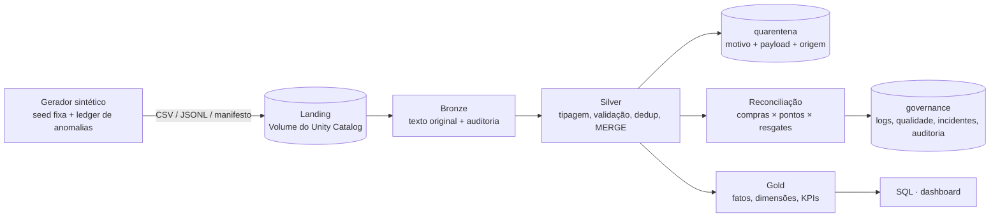
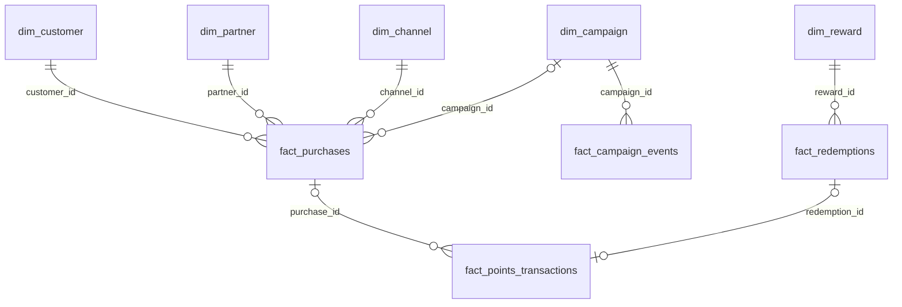

# Loyalty Commerce Lakehouse

> Lakehouse de um programa de fidelidade e comércio digital **fictício**: dados sintéticos →
> Bronze → Silver → Gold com **PySpark**, **Delta Lake** e **Unity Catalog** no **Databricks Free
> Edition**, com qualidade de dados, reconciliação de pontos, KPIs de negócio e testes automatizados.

**Todos os dados deste repositório são sintéticos.** Não há dados pessoais, internos ou de empresas
reais; nomes de parceiros e campanhas são inventados. O segmento (programas de pontos, parceiros,
resgates) serve só de contexto.

---

## 1. Problema de negócio

Um programa de pontos recebe dados de vários sistemas: compras (e-commerce e lojas), um motor de
pontos, uma plataforma de resgates, uma ferramenta de campanhas e cadastros. Cada fonte tem
atrasos, reenvios, duplicidades e erros. As perguntas de negócio, como "quanto vendemos?", "os
pontos foram creditados no prazo?", "o saldo dos clientes está correto?" e "a campanha converteu?",
só têm resposta confiável se os dados forem **consolidados, validados e reconciliados** com regras
explícitas.

## 2. Objetivos

Demonstrar, com código executável e resultados reais:
PySpark e Spark SQL · leitura/escrita CSV, JSON, Parquet e Delta · arquitetura Medallion · MERGE
incremental e idempotente · time travel e schema enforcement · Unity Catalog · modelagem dimensional
com granularidade explícita · regras de qualidade e reconciliação · métricas de fidelidade,
vendas, campanhas e retenção · testes automatizados · documentação técnica e de negócio.

## 3. Arquitetura



### Medallion

| Camada | Responsabilidade | Técnica principal |
|---|---|---|
| **Bronze** | preservar o dado original e rastrear a ingestão | schema explícito em texto, `_metadata.file_path`, `replaceWhere` por lote, manifesto de controle |
| **Silver** | dado confiável no estado atual | `try_cast`, validações, window de dedup, ação por linha, `MERGE INTO`, quarentena |
| **Gold** | pronto para decisão | modelo dimensional (6 dimensões, 4 fatos) + 17 tabelas de indicadores |
| **governance** | controle operacional do pipeline | log de execução, resultados de qualidade, incidentes, reconciliação |

Detalhes e decisões: [docs/architecture.md](docs/architecture.md).

## 4. Tecnologias (versões testadas)

Python 3.12.10 · PySpark 4.0.4 · delta-spark 4.0.1 · Databricks Connect 17.3.15 · Databricks SDK
0.157 · Databricks CLI 1.22.1 · Databricks Free Edition serverless (DBR 19.12) · Unity Catalog ·
pandas 3.1 · pyarrow 26 · Plotly · pytest 9.1 · GitHub Actions. Compatibilidade e limitações:
[docs/limitations.md](docs/limitations.md).

## 5. Modelo de dados

Fontes (lotes `B001_20250501` e `B002_20250701`): `customers`, `partners`, `campaigns`, `channels`,
`rewards` (CSV), `purchases`, `redemptions` (CSV), `points_transactions`, `campaign_events` (JSON Lines).



| Fato | Grão |
|---|---|
| `fact_purchases` | uma linha por compra |
| `fact_points_transactions` | uma linha por movimentação de pontos (CREDIT, DEBIT, EXPIRATION, ADJUSTMENT) |
| `fact_redemptions` | uma linha por solicitação de resgate |
| `fact_campaign_events` | uma linha por evento (EXPOSURE, CLICK, CONVERSION, PURCHASE_ATTRIBUTED) |

Dicionário completo (tipos, chaves, regras): [docs/data_dictionary.md](docs/data_dictionary.md) ·
Linhagem: [docs/data_lineage.md](docs/data_lineage.md).

## 6. Regras de negócio (resumo)

* **Vendas:** concluída = COMPLETED ou RETURNED; líquido = bruto − desconto; valor realizado exclui
  devoluções; canceladas e pendentes ficam fora das medidas financeiras.
* **Pontos:** CREDIT +, DEBIT −, EXPIRATION −, ADJUSTMENT com sinal. Só COMPLETED até a data de
  referência afeta o saldo. Um crédito por compra; crédito sem compra só nas exceções documentadas.
  Saldo = acumulado de todo o histórico (window por cliente), com detecção de saldo negativo.
* **Prazo de crédito (72 h, configurável):** no prazo / atrasado / pendente no prazo / pendente vencido;
  pendentes nunca contam como concluídos.
* **Resgates:** só COMPLETED conta; o saldo vem apenas do razão de pontos (sem dupla contagem).
* **Campanhas:** atribuição = código da campanha + venda na vigência + exposição/clique nos 7 dias
  anteriores; clientes únicos; **sem ROI** (não há custos) e **sem afirmação de causalidade**.
* **Clientes:** atividades medidas separadamente; recorrente = ≥ 2 compras em ≥ 2 dias no mês;
  inativo = 90 dias sem compra (não é "churn").

Todas as regras, com o código e o teste de cada uma: [docs/business_rules.md](docs/business_rules.md).

## 7. Principais indicadores

Vendas (concluídas, bruto, descontos, líquido, realizado, ticket, variação, por parceiro, categoria
e canal) · Pontos (creditados, debitados, expirados, ajustes, saldo, % no prazo, pendentes vencidos,
duplicados, taxa de inconsistência) · Resgates (solicitados, concluídos, taxa de conclusão, pontos,
tempo médio, divergências) · Campanhas (expostos, convertidos, conversão, compras e faturamento
atribuídos) · Clientes (ativos por atividade, recorrência, frequência, coortes, retenção, inativos)
· Qualidade (duplicidade, inválidos, integridade referencial, rejeitados, incidentes, % aprovadas).
Fórmulas, numeradores, denominadores e exclusões: [docs/metric_definitions.md](docs/metric_definitions.md).

## 8. Instalação

Pré-requisitos: Python 3.12 e Git. Para Spark local: Java 17. Use **dois ambientes virtuais**, porque
`databricks-connect` e `pyspark` não podem ficar no mesmo ambiente. Mantenha o repositório fora de
pastas sincronizadas (OneDrive e similares).

```bash
git clone https://github.com/robertluiscp/loyalty-commerce-lakehouse.git
cd loyalty-commerce-lakehouse

# Ambiente Databricks (execução remota no serverless)
python -m venv .venv-dbx
.venv-dbx/Scripts/activate        # Linux/macOS: source .venv-dbx/bin/activate
pip install -r requirements-databricks.txt

# Ambiente local (testes Spark / pipeline local com Delta) - em outro terminal
python -m venv .venv-local
.venv-local/Scripts/activate
pip install -r requirements.txt
```

## 9. Execução local

```bash
python scripts/generate_data.py                 # dados sintéticos em data/generated (~24 MB)
python scripts/run_tests.py unit                # testes Python puros
python scripts/run_tests.py spark               # regras com Spark local em memória (Java 17)
python scripts/run_local_pipeline.py            # pipeline completa com Delta local (Linux/macOS/WSL)
python -m loyalty_lakehouse.benchmark --mode local   # com PYTHONPATH=src
```

> **Windows:** o Spark local só lê e processa em memória; para **gravar** arquivos ele exige
> `winutils.exe`/`hadoop.dll`. Use WSL2, o GitHub Actions ou o caminho Databricks abaixo.

## 10. Execução no Databricks (Free Edition)

1. Crie a conta em <https://www.databricks.com/learn/free-edition> (serviço web, sem instalação).
2. Autentique a CLI por OAuth (o navegador abre para o login; nenhum token fica no código):
   ```bash
   databricks auth login --host https://<seu-workspace>.cloud.databricks.com --profile DEFAULT
   ```
3. Crie catálogo, schemas e volume: execute `sql/unity_catalog_setup.sql` (seções 1-2) no SQL
   Editor, **ou** deixe a pipeline criar os schemas (o catálogo e o volume precisam existir).
4. Rode a pipeline a partir da sua máquina (gera os dados, envia ao Volume e processa):
   ```bash
   python scripts/run_databricks_pipeline.py            # ~10 min, dominado pela latência do Connect
   python scripts/build_dashboard.py --env databricks   # dashboard + snapshot de resultados
   ```
5. Opcional: importe o repositório como **Git folder** no workspace e abra `notebooks/01...06`.

## 11. Unity Catalog

```
loyalty_lakehouse
├── bronze       (9 tabelas + volume landing)
├── silver       (9 tabelas + quarantine + tabelas de estágio e de demonstração)
├── gold         (27 tabelas)
└── governance   (4 tabelas)
```

| Item | Status no Free Edition |
|---|---|
| Catálogo, schemas, volume, tabelas Delta gerenciadas | **executado** |
| Consultas de metadados (`information_schema`, `SHOW GRANTS`) | **executado** |
| GRANTs de menor privilégio para grupos | **script pronto, não executado** (sem grupos/SCIM no Free Edition) |
| Lineage e auditoria nativos (system tables) | **não verificado**; linhagem documentada manualmente |

O schema `governance` é uma escolha do projeto, não um recurso do Unity Catalog. Ver
[docs/governance.md](docs/governance.md).

## 12. Testes

| Grupo | Comando | Onde roda | Resultado |
|---|---|---|---|
| Unitários Python (gerador, config) | `python scripts/run_tests.py unit` | qualquer SO | **12 passaram** |
| Regras com Spark local em memória (Silver, pontos, SLA, campanhas, reconciliação, Gold) | `python scripts/run_tests.py spark` | qualquer SO com Java 17 | **36 passaram** (Windows) |
| Integração Delta local | `python scripts/run_tests.py delta` | Linux/macOS/WSL, GitHub Actions | preparado; ainda não executado (roda no CI) |
| Integração Databricks (cria schemas `it_*` e os remove) | `python scripts/run_tests.py databricks` | ambiente com databricks-connect | **1 passou** (~11 min): ledger 100%, idempotência, time travel, logs |

Os testes unitários usam cenários pequenos com resultado conhecido (ex.: saldo 100 − 30 − 20 − 10 = 40;
taxa no prazo 3/4 com o pendente fora do denominador). Relatório: `docs/results/test_report.txt`.

## 13. Resultados reais da execução (Databricks Free Edition)

Volume padrão (seed 42): 3.000 clientes, 30 parceiros, 10 campanhas, 30.000 compras, ~31 mil
movimentações de pontos, 1.309 resgates e ~19,6 mil eventos de campanha em 2 lotes.
Data de referência: 01/07/2025. Fonte: `docs/results/gold_snapshot.json`.

**Detecção das anomalias injetadas:** os 200 registros do ledger (18 tipos de anomalia, 20
expectativas por camada) foram detectados na camada esperada (quarentena da Silver, reconciliação,
incidente da Bronze ou indicador da Gold), **sem falsos positivos**. Fonte:
`docs/results/ledger_comparison.json`.

| Indicador | Valor |
|---|---|
| Vendas concluídas | 27.481 |
| Faturamento bruto / descontos | R$ 13.100.598,31 / R$ 494.640,92 |
| Faturamento líquido / valor realizado | R$ 12.605.957,39 / R$ 12.073.477,27 |
| Ticket médio | R$ 458,72 |
| Compras canceladas (fora das medidas) | 2.065 |
| Pontos creditados / saldo total | 13.076.120 / 11.360.021 |
| Créditos concluídos no prazo | 93,7% (26.621 de 28.410 concluídos) |
| Créditos pendentes vencidos | 20 |
| Taxa de inconsistência de pontos | 0,056% (16 divergências / 28.466 eventos auditados) |
| Clientes com saldo negativo | 8 |
| Resgates concluídos / taxa de conclusão | 979 / 75,5% (pendentes fora do denominador) |
| Compradores ativos em jun/2025 / recorrentes | 2.079 / 1.253 (60,3%) |
| Verificações de qualidade aprovadas | 49 de 51 (96,1%). As 2 reprovadas são saldo negativo e créditos vencidos, que existem de propósito e abriram incidentes |

**Idempotência:** reexecutar os 2 lotes sobre a Silver existente (87.972 linhas de origem) resultou em
**zero `INSERT`/`UPDATE`**: 87.502 `UNCHANGED` (reenvio idêntico), 329 `STALE` (versão do lote 1 mais
antiga que a atual) e 141 de volta à quarentena, que foi substituída e não duplicada.

**Delta Lake** (`docs/results/delta_demo.json`): no histórico de `silver.purchases`, a versão 1 (MERGE
do lote 1) inseriu 15.851 linhas, a versão 2 (lote 2) inseriu 14.149 e atualizou 80, e os MERGEs de
reexecução (versões 3 a 6) registram 0 linhas inseridas e 0 atualizadas. Numa tabela de demonstração,
`VERSION AS OF` lê 15.851 linhas antes do MERGE e 30.000 depois. Ler versões com mais de 7 dias foi
**bloqueado** pela retenção (`delta.deletedFileRetentionDuration` = 168 horas): time travel não é
backup. Gravar texto numa coluna `BIGINT` e acrescentar coluna sem `mergeSchema` foram **rejeitados**;
com `mergeSchema` o schema evoluiu. Overwrite em Parquet perde a versão anterior; em Delta, a versão
anterior continua legível.

## 14. Benchmark CSV × Parquet

Metodologia: [docs/benchmark_methodology.md](docs/benchmark_methodology.md). Mesmos dados (compras
replicadas 10×), mediana das repetições.

**Local: pandas 3.1 + pyarrow 26** (Windows, Ryzen 5 3400G; 301.950 linhas × 13 colunas; 5 repetições;
arquivos no cache do sistema operacional) · `docs/results/benchmark_local.json`

| Formato | Tamanho | Escrita | Leitura completa | 2 colunas + agregação |
|---|---|---|---|---|
| CSV | 37,4 MB | 1,76 s | 0,056 s | 0,115 s |
| Parquet (snappy) | **5,0 MB** (7,5× menor) | **0,34 s** | 0,040 s | **0,026 s** (4,4× mais rápido) |

**Spark no Databricks serverless via Connect** (300.000 linhas; 3 repetições) · `docs/results/benchmark_databricks.json`

| Formato | Tamanho | Escrita | Leitura completa (`noop`) | 2 colunas + agregação |
|---|---|---|---|---|
| CSV | 40,5 MB | 2,81 s | 1,38 s | 1,52 s |
| Parquet | **3,7 MB** (11× menor) | 2,05 s | 0,98 s | 1,29 s |
| Delta | **3,6 MB** na versão atual · 32,2 MB no diretório\* | 1,68 s | 0,77 s | 0,62 s |

\* As escritas repetidas em modo overwrite não apagam arquivos: o Delta retém as versões anteriores
para time travel até um `VACUUM`, então o diretório acumula as repetições de todas as execuções do
benchmark. `DESCRIBE DETAIL` mede só a versão atual.

> Os números valem para este volume, este hardware e esta configuração. No Databricks Connect,
> os tempos incluem a ida e volta de rede e diferenças de décimos de segundo são ruído. O resultado
> robusto é o tamanho. Delta não é "mais rápido que Parquet" por natureza: os ganhos dele são ACID,
> MERGE e time travel.

## 15. Exemplos de consultas SQL

```sql
-- Faturamento por categoria (medidas aditivas somadas; ticket recalculado, não média de médias)
SELECT partner_category, sum(completed_purchases) AS vendas, sum(net_sales) AS liquido,
       round(sum(net_sales) / nullif(sum(completed_purchases), 0), 2) AS ticket_medio
FROM loyalty_lakehouse.gold.kpi_daily_sales
GROUP BY partner_category ORDER BY liquido DESC;

-- Saldo acumulado com window function e menor saldo atingido (detecção de saldo negativo)
SELECT customer_id, sum(signed_points) AS saldo, min(running_balance) AS menor_saldo
FROM (SELECT customer_id, signed_points,
             sum(signed_points) OVER (PARTITION BY customer_id
               ORDER BY actual_completion_timestamp, points_transaction_id) AS running_balance
      FROM loyalty_lakehouse.gold.fact_points_transactions WHERE affects_balance)
GROUP BY customer_id HAVING min(running_balance) < 0;
```

Todas as consultas: `sql/business_kpis.sql` (Q01-Q16), `sql/data_quality.sql`, `sql/reconciliation.sql`.
As 39 instruções foram executadas no Databricks sem erro (`docs/results/sql_checks.json`).

## 16. Dashboard

`docs/dashboard/index.html`, gerado de verdade a partir das tabelas Gold. Tem 5 seções: visão executiva,
operação de pontos, campanhas, clientes e qualidade. Especificação e montagem no Databricks AI/BI ou
Metabase: [docs/dashboard.md](docs/dashboard.md).

## 17. Estrutura do repositório

```
config/      local.yaml, databricks.example.yaml
src/loyalty_lakehouse/  config, schemas, data_generator, ingestion, bronze, silver, reconciliation,
             business_metrics, gold, quality, governance, pipeline, benchmark, delta_features, utils
notebooks/   01-06 (formato fonte do Databricks) + _setup
sql/         unity_catalog_setup, business_kpis, data_quality, reconciliation
tests/       unit/ (Python + Spark em memória), integration/ (Delta local, Databricks)
scripts/     generate_data, run_local_pipeline, run_databricks_pipeline, run_tests,
             run_sql_checks, build_dashboard
docs/        arquitetura, dicionário, regras, qualidade, governança, linhagem, métricas,
             benchmark, limitações, dashboard, portfólio, results/
```

## 18. Limitações conhecidas

Spark local no Windows não grava arquivos sem winutils · Free Edition: só serverless, cota diária,
sem grupos/GRANTs · latência do Databricks Connect domina o tempo · time travel limitado à retenção ·
Gold em full refresh · Silver SCD1 · expiração vem da origem · atribuição de campanha simples e não
causal · devolução atribuída à data da venda. Lista completa: [docs/limitations.md](docs/limitations.md).

## 19. Próximas melhorias

Databricks Jobs / Lakeflow Declarative Pipelines com expectations · Auto Loader · SCD2 em clientes ·
Gold incremental · expiração FIFO · reprocessamento da quarentena · dashboard AI/BI publicado · GRANTs
num workspace com grupos.

## 20. Declaração sobre os dados

Todos os dados são **sintéticos**, gerados por `src/loyalty_lakehouse/data_generator.py` com seed
fixa. As anomalias são **artificiais** e existem só para testar a pipeline. Nenhum resultado deste
repositório representa um negócio real ou um ambiente de produção.

---

Material para LinkedIn e entrevistas: [docs/portfolio.md](docs/portfolio.md).
