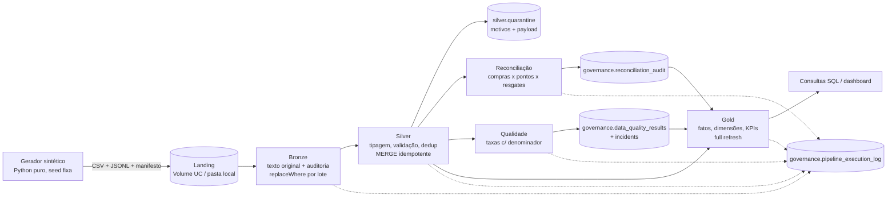

# Arquitetura

## Visão geral



## Organização lógica (Unity Catalog)

```
loyalty_lakehouse                  (catálogo)
├── bronze      9 tabelas brutas + volume `landing`
├── silver      9 tabelas de estado atual + quarantine (+ stg_* transitórias e 2 tabelas de demonstração Delta)
├── gold        6 dimensões, 4 fatos, 17 tabelas de indicadores
└── governance  pipeline_execution_log, data_quality_results, data_quality_incidents, reconciliation_audit
```

No modo local as mesmas camadas são diretórios de tabelas Delta por caminho:
`data/lakehouse/<camada>/<tabela>` (sem metastore), referenciadas como ``delta.`<caminho>```.

## Decisões técnicas

| Decisão | Justificativa | Alternativa descartada |
|---|---|---|
| Bronze em **texto** (StringType) | preserva o valor original; erros de tipo viram motivos rastreáveis na Silver | inferir schema (corrige/perde valores silenciosamente) |
| Schema CSV construído **a partir do cabeçalho** | evita desalinhamento posicional quando a origem muda a ordem ou acrescenta colunas | schema fixo com `enforceSchema` |
| **Manifesto** por lote | detecta arquivo ausente e divergência de contagem origem x Bronze | confiar na listagem do diretório |
| Idempotência na Bronze com `replaceWhere _batch_id` | reprocessar substitui só o lote | append (duplicaria) |
| Silver com **ação por linha** + `MERGE INTO` | separa claramente inserção, atualização, reenvio, versão antiga e rejeição; reexecução não altera o estado | sobrescrever a tabela a cada lote |
| Estado atual **SCD tipo 1** | indicadores usam o status vigente; o histórico fica no Delta (time travel) e na Bronze | SCD2 (mais complexo, sem necessidade nos KPIs) |
| Quarentena única com `reasons array<string>` | uma consulta mostra todas as rejeições, com todos os motivos | uma tabela de rejeitados por entidade |
| Reconciliação **separada** da validação | divergências entre entidades não são "registro inválido"; viram pendência operacional | rejeitar créditos divergentes (perderia rastreabilidade do razão) |
| Saldo **somente** pelo razão de pontos | evita contar resgate duas vezes (resgate + débito) | somar resgates e débitos |
| Gold em **full refresh** | determinística e barata neste volume; incrementalidade fica na Silver | MERGE também na Gold (complexidade sem ganho aqui) |
| Gold calculada por função pura (`compute_gold`) | testável em memória com DataFrames pequenos | lógica acoplada à escrita |
| Estágio materializado (`silver.stg_*`) | serverless não suporta `cache()`; evita recomputar o plano em cada ação | recomputar o DataFrame 3-4 vezes |
| Broadcast das dimensões nos joins de integridade | dimensões pequenas: evita shuffle da tabela de fatos | sort-merge join |
| Sem particionamento físico | ~30 mil linhas por tabela: partições gerariam arquivos minúsculos | particionar por data |
| Timestamps em UTC + data de negócio em `America/Sao_Paulo` | instantes comparáveis; datas de negócio corretas perto da meia-noite | timestamps locais sem fuso |

## Operações distribuídas e shuffle

| Etapa | Operação | Gera shuffle? |
|---|---|---|
| Bronze | leitura CSV/JSON, `withColumn`, `sha2` | não (narrow) |
| Silver - integridade | join com dimensão `broadcast` | não (a dimensão é copiada para os executores) |
| Silver - dedup | `Window.partitionBy(chave)` | sim, pela chave |
| Silver - estado atual | join lote x Silver pela chave | sim (ambos os lados) |
| Silver - crédito duplicado | window por `purchase_id` | sim |
| Reconciliação - saldo | window por `customer_id` ordenada | sim |
| Gold - KPIs | `groupBy` | sim (agregação parcial antes do shuffle) |
| Gold - `kpi_monthly_sales` | `Window.orderBy(month)` sem partição | move tudo para 1 partição: aceitável com ~6 linhas |

`collect()` só é usado em agregados pequenos (contagens por ação/motivo/verificação). Nenhuma tabela
de fatos é trazida para o driver.

## Ambientes

| | Local | Databricks Free Edition |
|---|---|---|
| Motor | pyspark 4.0 + delta-spark 4.0 | serverless (DBR 19.x) via Databricks Connect 17.3 |
| Tabelas | Delta por caminho | Delta gerenciadas pelo Unity Catalog |
| Landing | `data/generated/landing` | Volume `loyalty_lakehouse.bronze.landing` |
| Status | lógica testada em memória no Windows; Delta local preparado para Linux/WSL/CI | **executado de ponta a ponta** |

Detalhes e o que foi efetivamente executado: [limitations.md](limitations.md).
