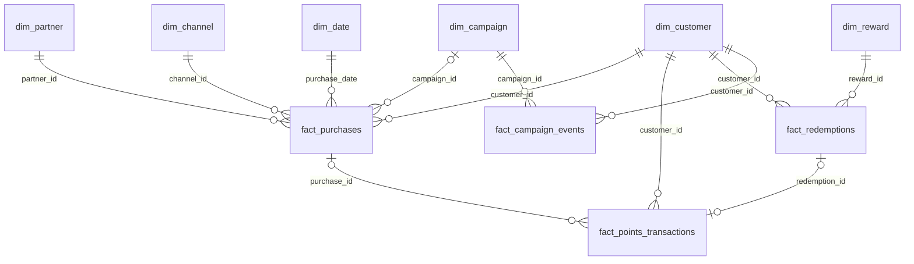

# Dicionário de dados

Convenções: timestamps são `TIMESTAMP` (instante em UTC); datas de negócio (`*_date`) estão no fuso
`America/Sao_Paulo`; valores monetários `DECIMAL(12,2)` em BRL; pontos `BIGINT`.
Colunas com prefixo `_` são técnicas (auditoria). **Todos os dados são sintéticos.**

## Relacionamentos (modelo dimensional da Gold)

**Integridade referencial:** garantida na Silver (registros com chave estrangeira inexistente vão
para a quarentena com `UNKNOWN_*`/`ORPHAN_*`). Exceções: `campaign_id`, `purchase_id` e
`redemption_id` são opcionais (nulos permitidos) conforme as regras em `business_rules.md`.

**Granularidade e joins entre fatos:** os fatos têm grãos diferentes. Nunca some medidas de
`fact_purchases` depois de juntar com `fact_points_transactions` (uma compra pode ter crédito,
bônus e estorno → linhas multiplicadas). Agregue cada fato no grão comum antes de juntar,
como `kpi_partner_monthly` faz com os pontos por compra.

## Bronze (`bronze.<entidade>`)

Grão: uma linha por linha do arquivo de origem, por lote. Todas as colunas de negócio são `STRING`
(valor original). Colunas técnicas:

| Coluna | Tipo | Descrição |
|---|---|---|
| `_extra_columns` | STRING (JSON) | colunas do CSV fora do contrato (schema drift) |
| `_corrupt_record` | STRING | linha malformada (modo PERMISSIVE) |
| `_source_file` | STRING | caminho do arquivo (`_metadata.file_path`) |
| `_record_hash` | STRING | SHA-256 dos valores originais |
| `_batch_id` | STRING | lote de extração (`B001_20250501`, `B002_20250701`) |
| `_run_id` | STRING | execução da pipeline que gravou a linha |
| `_ingestion_timestamp` | TIMESTAMP | instante da ingestão |

## Silver

Grão: uma linha por chave de negócio (estado atual, SCD tipo 1). Colunas técnicas comuns:
`_batch_id`, `_source_file`, `_ingestion_timestamp`, `_record_hash` (do último lote que alterou a
linha), `_content_hash` (hash dos campos de negócio normalizados), `_corrections ARRAY<STRING>`,
`_silver_updated_at`.

### `silver.customers` - chave `customer_id`
| Coluna | Tipo | Descrição / regra |
|---|---|---|
| customer_id | STRING | `C` + 6 dígitos |
| registration_date | DATE | data de cadastro |
| customer_segment | STRING | ENTRY, REGULAR, PREMIUM, VIP |
| region | STRING | NORTE, NORDESTE, CENTRO_OESTE, SUDESTE, SUL |
| preferred_channel | STRING | canal preferido (nome) |
| is_active | BOOLEAN | cadastro ativo |
| created_at | TIMESTAMP | criação do cadastro |

### `silver.partners` - chave `partner_id`
partner_id (`P`+3 dígitos), partner_name (nome **fictício**), partner_category, region,
partner_status (ACTIVE/INACTIVE), onboarding_date (DATE).

### `silver.campaigns` - chave `campaign_id`
campaign_id (`CMP`+3), campaign_name, campaign_type (MULTIPLIER/BONUS/AWARENESS), start_date,
end_date (DATE, `end >= start`), campaign_status (PLANNED/ACTIVE/ENDED), target_segment (ALL ou
segmento), points_multiplier (DECIMAL(4,2) ≥ 1).

### `silver.channels` - chave `channel_id`; `silver.rewards` - chave `reward_id`
channels: channel_id, channel_name, channel_type. rewards: reward_id, reward_name, reward_category,
points_cost (BIGINT > 0), partner_id (opcional).

### `silver.purchases` - chave `purchase_id`
| Coluna | Tipo | Descrição / regra |
|---|---|---|
| purchase_id | STRING | `PU` + 8 dígitos |
| customer_id, partner_id, channel_id | STRING | FKs obrigatórias |
| purchase_timestamp | TIMESTAMP | ISO-8601 com fuso na origem |
| purchase_date | DATE | data de negócio (São Paulo) |
| gross_amount, discount_amount, net_amount | DECIMAL(12,2) | `net = gross − discount`, sem negativos |
| currency | STRING | BRL |
| purchase_status | STRING | PENDING, COMPLETED, CANCELLED, RETURNED |
| status_updated_at | TIMESTAMP | versão do registro (ordena atualizações) |
| campaign_id | STRING | código de campanha aplicado (opcional) |
| source_system | STRING | ECOMMERCE / POS |

### `silver.points_transactions` - chave `points_transaction_id`
| Coluna | Tipo | Descrição / regra |
|---|---|---|
| points_transaction_id | STRING | `PT` + 9 dígitos |
| purchase_id | STRING | obrigatório em CREDIT/PURCHASE |
| redemption_id | STRING | obrigatório em DEBIT |
| customer_id | STRING | FK |
| transaction_type | STRING | CREDIT, DEBIT, EXPIRATION, ADJUSTMENT |
| reason_code | STRING | PURCHASE, WELCOME_BONUS, CAMPAIGN_BONUS, REDEMPTION, POINTS_EXPIRED, PURCHASE_RETURN, MANUAL_GOODWILL |
| points_amount | BIGINT | magnitude (>0) exceto ADJUSTMENT (com sinal, ≠0) |
| transaction_timestamp | TIMESTAMP | criação da movimentação |
| status | STRING | PENDING, COMPLETED, REJECTED, CANCELLED |
| status_updated_at | TIMESTAMP | versão |
| expected_completion_timestamp | TIMESTAMP | prazo previsto (créditos) |
| actual_completion_timestamp | TIMESTAMP | conclusão efetiva |
| expiration_date | DATE | validade do crédito |
| operator_id | STRING | responsável por ajustes |
| source_system | STRING | POINTS_ENGINE |

### `silver.redemptions` - chave `redemption_id`
redemption_id (`RD`+7), customer_id, reward_id, partner_id (opcional), redemption_timestamp,
points_used (BIGINT > 0), redemption_status (REQUESTED/COMPLETED/REJECTED/CANCELLED),
status_updated_at, completion_timestamp (obrigatório se COMPLETED), source_system.

### `silver.campaign_events` - chave `event_id` (imutável, insert-only)
event_id (`EV`+9), campaign_id, customer_id, event_type (EXPOSURE/CLICK/CONVERSION/
PURCHASE_ATTRIBUTED), event_timestamp, event_date, channel_id, purchase_id (obrigatório em
CONVERSION/PURCHASE_ATTRIBUTED), source_system.

### `silver.quarantine` - grão: uma linha rejeitada por entidade e lote
| Coluna | Tipo | Descrição |
|---|---|---|
| entity | STRING | entidade de origem |
| business_key | STRING | chave de negócio (pode ser nula, ex.: JSON malformado) |
| reasons | ARRAY<STRING> | todos os motivos |
| primary_reason | STRING | primeiro motivo (para agregação) |
| raw_record | STRING | valores originais em JSON, ou o texto bruto da linha malformada |
| _batch_id, _source_file, _ingestion_timestamp, _record_hash, _run_id | | rastreabilidade |
| quarantined_at | TIMESTAMP | execução que rejeitou |

## Gold

| Tabela | Grão | Principais colunas |
|---|---|---|
| dim_date | data | date, year, month, month_start, iso_week, day_of_week, is_weekend |
| dim_customer / dim_partner / dim_campaign / dim_channel / dim_reward | 1 por chave | colunas de negócio da Silver |
| fact_purchases | compra | colunas da Silver + is_sold, is_realized, is_returned, is_cancelled, is_pending, gross_sales, discounts, net_sales, returns_amount, realized_revenue, attribution_status, attributed_campaign_id |
| fact_points_transactions | movimentação | colunas da Silver + signed_points, affects_balance, sla_category, completion_hours, movement_date, effective_date |
| fact_redemptions | resgate | colunas da Silver + redemption_date, completion_hours, has_debit_divergence |
| fact_campaign_events | evento | colunas da Silver |
| kpi_daily_sales | data × parceiro × canal | purchases_total, completed_purchases, realized_purchases, returned_purchases, cancelled_purchases, pending_purchases, gross_sales, discounts, net_sales, returns_amount, realized_revenue, buyers*, partner_category |
| kpi_monthly_sales | mês | medidas acima + avg_ticket, prev_month_net_sales, mom_net_sales_change_pct |
| kpi_partner_monthly | mês × parceiro | medidas + points_credited, avg_ticket, share_of_net_sales_pct |
| kpi_segment_monthly | mês × segmento | medidas + avg_ticket, purchase_frequency |
| kpi_points_daily | data × tipo × status | movements, points_abs, signed_points_effective |
| kpi_credit_sla_daily | data do crédito × categoria | credits, points, avg_completion_hours |
| kpi_points_summary | 1 linha | totais de pontos, saldo, categorias de SLA, on_time_credit_rate, duplicidades, divergências, points_inconsistency_rate e populações auditadas |
| kpi_redemptions_daily | data × categoria × status | redemptions, points_requested, points_used_completed, avg_completion_hours, debit_divergences |
| kpi_redemption_summary | 1 linha | requested, completed, rejected, cancelled, pending, completion_rate, points_used_completed, avg_completion_hours, debit_divergences |
| kpi_campaign_performance | campanha | exposures, exposed/clicked/converted_customers, click_rate, conversion_rate, attributed_purchases, attributed_net_sales, attributed_realized_revenue, tagged_without_exposure, tracking_* , roi (nulo) + roi_note |
| kpi_campaign_segment_channel | campanha × segmento × canal de exposição | exposed_customers*, converted_customers*, conversion_rate |
| customer_activity_monthly | cliente × mês | sold_purchases, purchase_days, net_sales, credits, redemption_requests, campaign_interactions, is_active_* , is_recurring_buyer |
| kpi_active_customers_monthly | mês | active_buyers, active_points_earners, active_redeemers, active_campaign_interactors, active_any_activity, recurring_buyers, recurring_rate, purchase_frequency, new_buyers |
| kpi_cohort_retention | coorte × meses desde a 1ª compra | active_customers, cohort_size, retention_rate |
| customer_snapshot | cliente (na referência) | dimensões + saldo/pontos, has_negative_balance, lifetime_*, last_purchase_date, days_since_last_purchase, inactivity_status |
| operational_backlog | grupo × tipo × entidade | open_items, points_at_stake, oldest_item_at |
| kpi_quality_summary | categoria de verificação | checks, checks_passed, pct_checks_passed, run_id |

\* contagens distintas **não aditivas**: não some `buyers`/`exposed_customers` entre linhas.

## Governance

| Tabela | Grão | Colunas |
|---|---|---|
| pipeline_execution_log | etapa × entidade × execução | run_id, batch_id, step, entity, status, started_at, finished_at, duration_seconds, rows_read, rows_written, rows_quarantined, message, environment |
| data_quality_results | verificação × entidade × lote × execução | check_name, check_category, population, numerator, denominator, metric_value, threshold, comparator, passed, severity |
| data_quality_incidents | incidente | incident_id, category, severity, description, affected_records, source_reference, status |
| reconciliation_audit | divergência (ou OK) × verificação × execução | check_name, entity, business_key, customer_id, expected_value, actual_value, difference, status, details |
