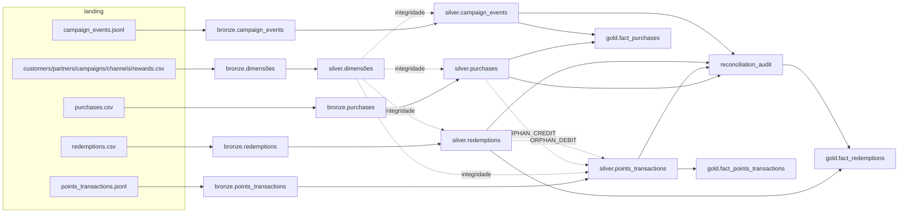

# Linhagem de dados

Documentação manual (o lineage nativo do Unity Catalog não foi verificado neste projeto - ver
`governance.md`). Cada linha da Bronze/Silver carrega `_source_file` e `_batch_id`, e cada registro
rejeitado fica em `silver.quarantine` com o payload original.

## Origem de cada tabela Gold

| Tabela Gold | Entradas | Transformações principais |
|---|---|---|
| dim_* | silver.customers/partners/campaigns/channels/rewards | remoção de colunas técnicas |
| dim_date | silver.purchases | `sequence(min(purchase_date), max(purchase_date))` |
| fact_purchases | silver.purchases, silver.campaign_events, silver.campaigns | `purchase_measures` (política financeira) + `attribute_purchases` (join por intervalo de 7 dias agregado por compra) |
| fact_points_transactions | silver.points_transactions | `signed_points`, `effective_flag`, `classify_credit_sla`, datas locais |
| fact_redemptions | silver.redemptions, governance.reconciliation_audit | horas de conclusão; flag de divergência de débito |
| fact_campaign_events | silver.campaign_events | — |
| kpi_daily_sales / kpi_monthly_sales | fact_purchases, silver.partners | `groupBy` + `lag` (variação mensal) |
| kpi_partner_monthly | fact_purchases, fact_points (créditos agregados POR COMPRA antes do join) | share por window `partitionBy(month)` |
| kpi_segment_monthly | fact_purchases, silver.customers | `groupBy(mês, segmento)` |
| kpi_points_daily / kpi_credit_sla_daily | fact_points_transactions | `groupBy` |
| kpi_points_summary | fact_points, `customer_balances`, silver.quarantine, reconciliation_audit, silver.purchases/redemptions | totais, SLA, duplicidades, taxa de inconsistência com população auditada |
| kpi_redemptions_daily / kpi_redemption_summary | fact_redemptions, silver.rewards | contagens por status, taxa de conclusão |
| kpi_campaign_performance | silver.campaign_events, fact_purchases, silver.campaigns | clientes únicos expostos/convertidos; ROI nulo |
| kpi_campaign_segment_channel | silver.campaign_events, fact_purchases, silver.customers | distintos por campanha × segmento × canal |
| customer_activity_monthly | fact_purchases, fact_points, fact_redemptions, silver.campaign_events | full outer join por (cliente, mês) |
| kpi_active_customers_monthly / kpi_cohort_retention | customer_activity_monthly | contagens; coorte = mês da 1ª venda |
| customer_snapshot | silver.customers, `customer_balances`, fact_purchases | saldo na referência, inatividade (90 dias) |
| operational_backlog | fact_points, fact_redemptions, silver.quarantine, reconciliation_audit | união de pendências |
| kpi_quality_summary | governance.data_quality_results (execução atual) | % de verificações aprovadas |
